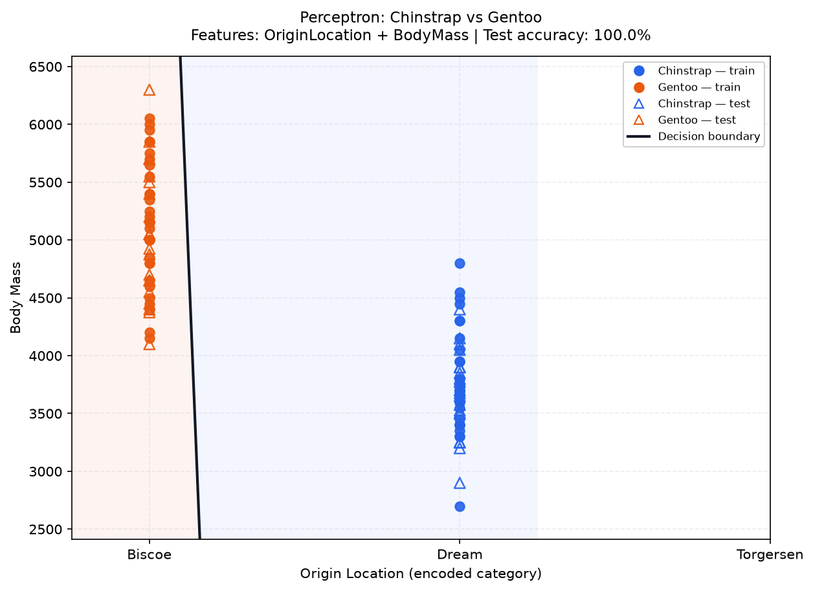
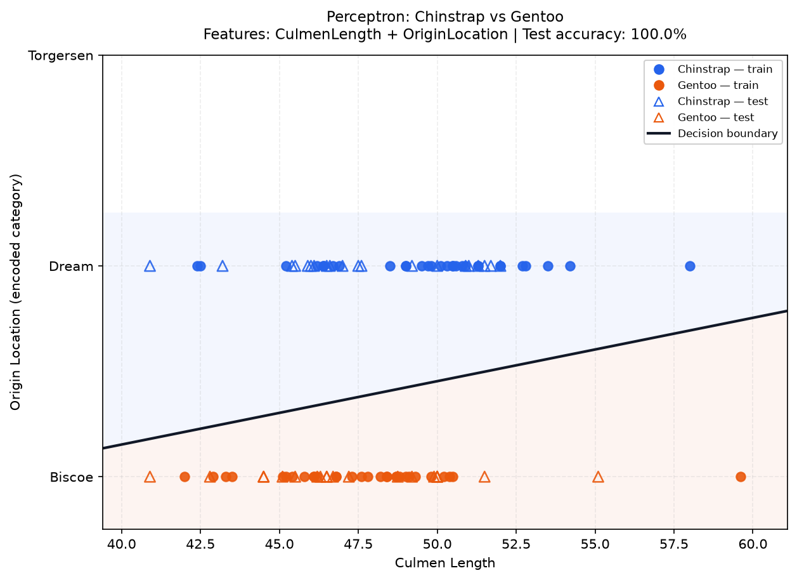
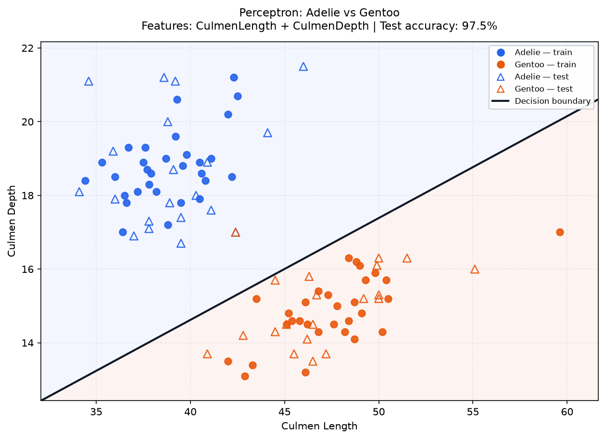
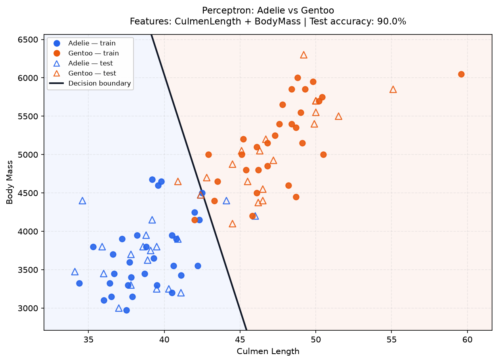
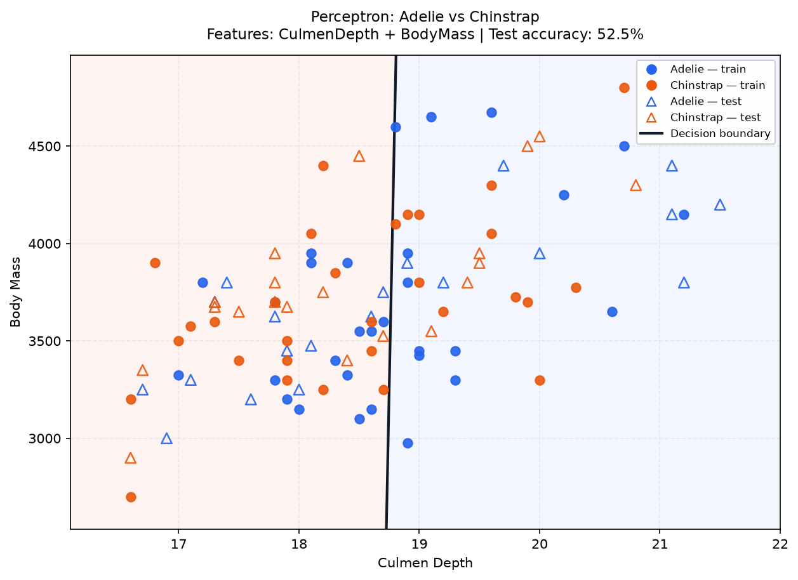
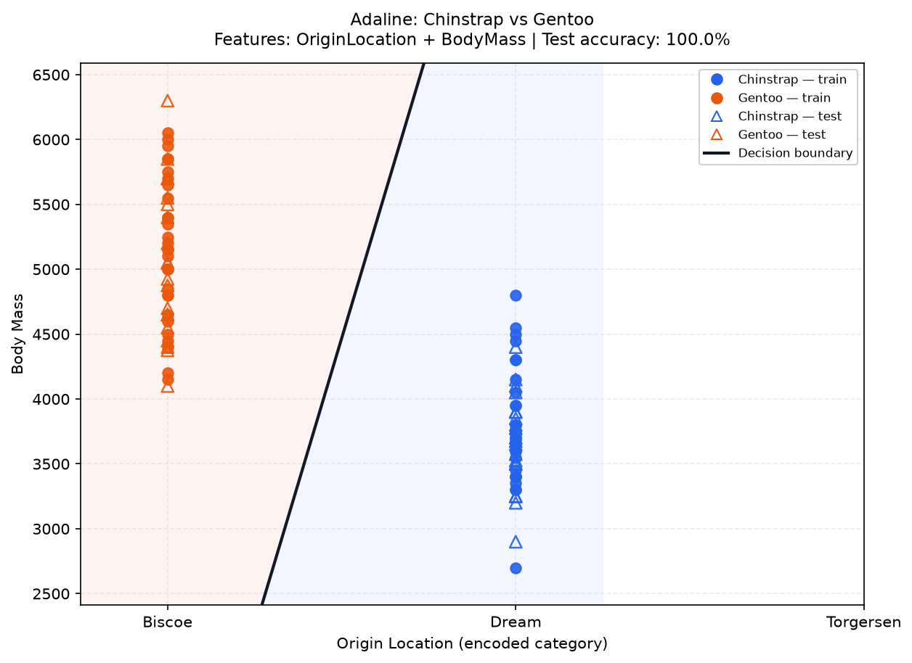
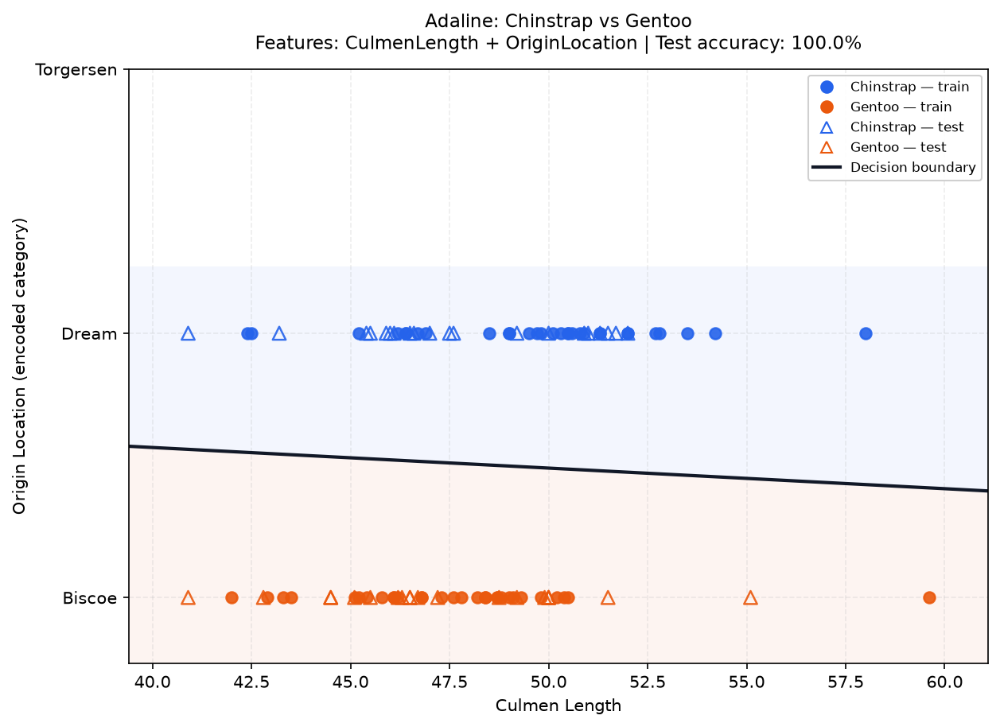
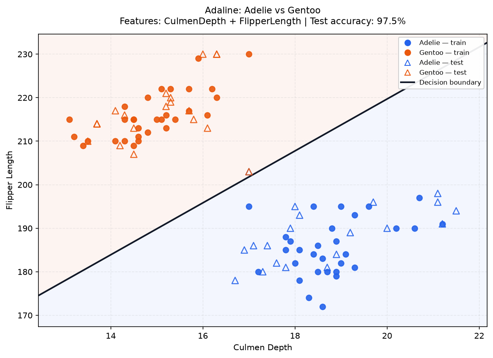
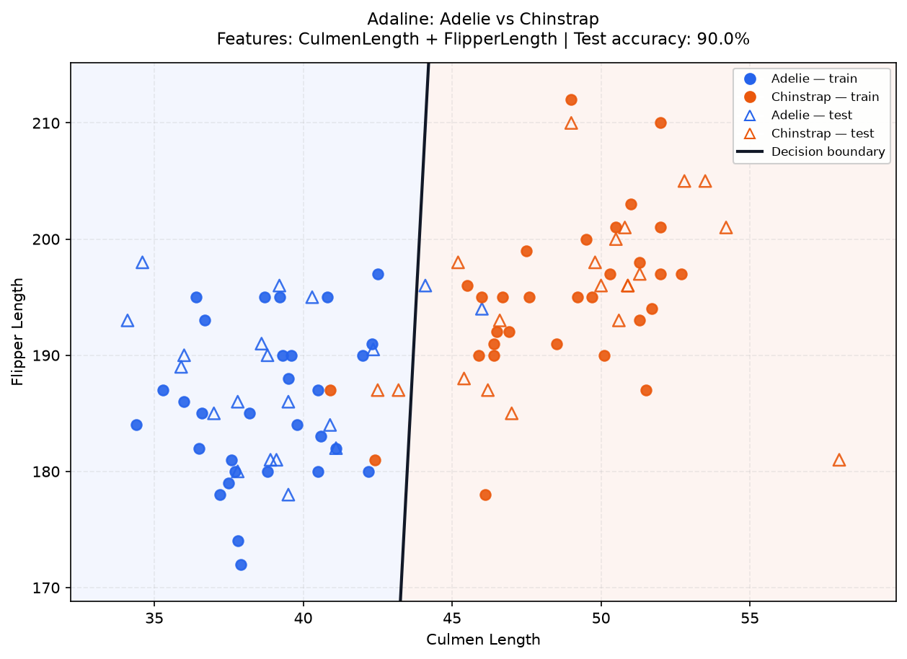
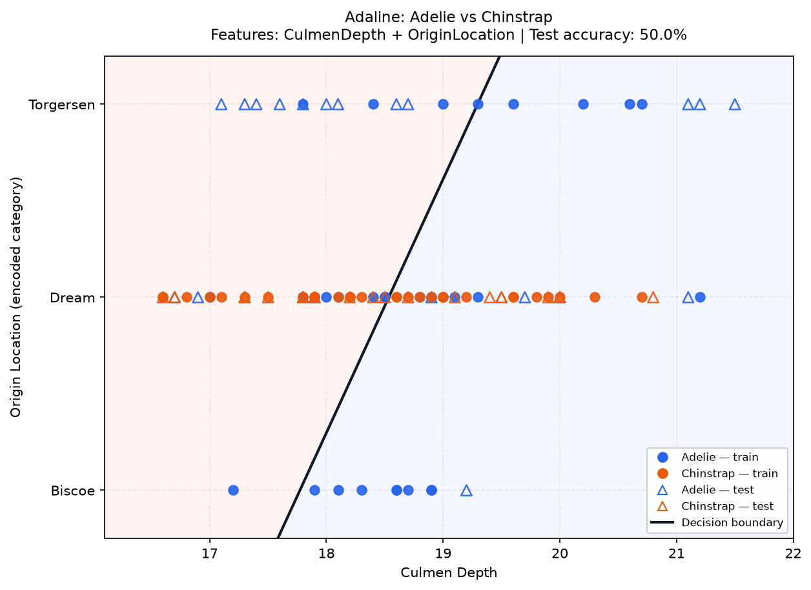

# Penguins Binary Classification — Lab 3 Analysis Report

## 1. Objective
Implement and compare Perceptron and Adaline on two-class Penguins classification tasks using exactly two selected features, as required by Lab 3.

## 2. Dataset and preprocessing
- Dataset: `penguins.csv`.
- Rows preserved during loading: **150**.
- Classes: Adelie, Chinstrap, Gentoo (the selected binary experiment uses the two classes shown in each result).
- Selectable features: CulmenLength, CulmenDepth, FlipperLength, OriginLocation, BodyMass.
- Numeric missing values are imputed with medians calculated from the training split only; no row is dropped.
- `OriginLocation` is mapped to a deterministic numeric code so it remains one selectable feature and the visualization stays two-dimensional. This coding is nominal, not ordinal; numeric distance between location codes has no real-world meaning.
- Each class contributes 30 non-repeated training samples and the remaining 20 testing samples. The fixed random seed is 42 so runs are reproducible.
- The two selected features are standardized with training-set means and standard deviations. Test data use the same training-derived values.
- Class A is encoded as -1; Class B as +1. Both decision boundaries are linear.
- No scikit-learn package or ready-made confusion-matrix utility is used. Confusion matrices and overall accuracy are computed by custom loops in `evaluation.py`.

## 3. Training settings
The generated comparison uses learning rate = 0.01, maximum epochs = 150, Bias enabled, and MSE threshold = 0.01 for Adaline. The GUI lets the user change these values for an individual run.
Perceptron updates weights when a sample is misclassified. Adaline uses stochastic gradient descent and updates its weights using the current sample's linear-output error; MSE is checked after each epoch.

## 4. Representative plots and analysis
Five different feature pairs are shown for each algorithm. Examples are selected across the observed performance ranking, from high to low. All 30 feature-pair/class-pair results per algorithm are included in `experiment_results.csv`.

### 4.1. Perceptron

#### 1. Highest-performing example
- **Classes:** Chinstrap (Class A, -1) vs Gentoo (Class B, +1).
- **Features:** `OriginLocation` and `BodyMass`.
- **Test accuracy:** 100.0% (40/40 correct).
- **Epochs used:** 2; **final training MSE:** 0.9672.

| Actual \ Predicted | Class A | Class B |
|---|---:|---:|
| Class A | 20 | 0 |
| Class B | 0 | 20 |

**Interpretation:** The model shows strong separation on this test split. Class recalls are Class A 100.0% and Class B 100.0%. A linear classifier can only learn a straight decision boundary in the selected two-feature space.

#### 2. Upper-range example
- **Classes:** Chinstrap (Class A, -1) vs Gentoo (Class B, +1).
- **Features:** `CulmenLength` and `OriginLocation`.
- **Test accuracy:** 100.0% (40/40 correct).
- **Epochs used:** 2; **final training MSE:** 0.8727.

| Actual \ Predicted | Class A | Class B |
|---|---:|---:|
| Class A | 20 | 0 |
| Class B | 0 | 20 |

**Interpretation:** The model shows strong separation on this test split. Class recalls are Class A 100.0% and Class B 100.0%. A linear classifier can only learn a straight decision boundary in the selected two-feature space.

#### 3. Middle-range example
- **Classes:** Adelie (Class A, -1) vs Gentoo (Class B, +1).
- **Features:** `CulmenLength` and `CulmenDepth`.
- **Test accuracy:** 97.5% (39/40 correct).
- **Epochs used:** 2; **final training MSE:** 0.9416.

| Actual \ Predicted | Class A | Class B |
|---|---:|---:|
| Class A | 20 | 0 |
| Class B | 1 | 19 |

**Interpretation:** The model shows strong separation on this test split. Class recalls are Class A 100.0% and Class B 95.0%. A linear classifier can only learn a straight decision boundary in the selected two-feature space.

#### 4. Lower-range example
- **Classes:** Adelie (Class A, -1) vs Gentoo (Class B, +1).
- **Features:** `CulmenLength` and `BodyMass`.
- **Test accuracy:** 90.0% (36/40 correct).
- **Epochs used:** 150; **final training MSE:** 0.8513.

| Actual \ Predicted | Class A | Class B |
|---|---:|---:|
| Class A | 18 | 2 |
| Class B | 2 | 18 |

**Interpretation:** The model shows strong separation on this test split. Class recalls are Class A 90.0% and Class B 90.0%. A linear classifier can only learn a straight decision boundary in the selected two-feature space.

#### 5. Lowest-performing example
- **Classes:** Adelie (Class A, -1) vs Chinstrap (Class B, +1).
- **Features:** `CulmenDepth` and `BodyMass`.
- **Test accuracy:** 52.5% (21/40 correct).
- **Epochs used:** 150; **final training MSE:** 0.9863.

| Actual \ Predicted | Class A | Class B |
|---|---:|---:|
| Class A | 8 | 12 |
| Class B | 7 | 13 |

**Interpretation:** The model shows weak separation for this linear model on this test split. Recall is uneven (Class A: 40.0%, Class B: 65.0%), so the overall accuracy should be read alongside the confusion matrix. A linear classifier can only learn a straight decision boundary in the selected two-feature space.

**Highest test accuracy for Perceptron: 100.0%.**
Best-performing feature/class combination(s): `CulmenLength + CulmenDepth` (Adelie vs Chinstrap); `CulmenLength + OriginLocation` (Chinstrap vs Gentoo); `CulmenDepth + FlipperLength` (Chinstrap vs Gentoo); `CulmenDepth + OriginLocation` (Chinstrap vs Gentoo); `CulmenDepth + BodyMass` (Chinstrap vs Gentoo); `FlipperLength + OriginLocation` (Adelie vs Gentoo); `FlipperLength + OriginLocation` (Chinstrap vs Gentoo); `OriginLocation + BodyMass` (Adelie vs Gentoo); `OriginLocation + BodyMass` (Chinstrap vs Gentoo).

### 4.2. Adaline

#### 1. Highest-performing example
- **Classes:** Chinstrap (Class A, -1) vs Gentoo (Class B, +1).
- **Features:** `OriginLocation` and `BodyMass`.
- **Test accuracy:** 100.0% (40/40 correct).
- **Epochs used:** 10; **final training MSE:** 0.0095.

| Actual \ Predicted | Class A | Class B |
|---|---:|---:|
| Class A | 20 | 0 |
| Class B | 0 | 20 |

**Interpretation:** The model shows strong separation on this test split. Class recalls are Class A 100.0% and Class B 100.0%. A linear classifier can only learn a straight decision boundary in the selected two-feature space.

#### 2. Upper-range example
- **Classes:** Chinstrap (Class A, -1) vs Gentoo (Class B, +1).
- **Features:** `CulmenLength` and `OriginLocation`.
- **Test accuracy:** 100.0% (40/40 correct).
- **Epochs used:** 5; **final training MSE:** 0.0051.

| Actual \ Predicted | Class A | Class B |
|---|---:|---:|
| Class A | 20 | 0 |
| Class B | 0 | 20 |

**Interpretation:** The model shows strong separation on this test split. Class recalls are Class A 100.0% and Class B 100.0%. A linear classifier can only learn a straight decision boundary in the selected two-feature space.

#### 3. Middle-range example
- **Classes:** Adelie (Class A, -1) vs Gentoo (Class B, +1).
- **Features:** `CulmenDepth` and `FlipperLength`.
- **Test accuracy:** 97.5% (39/40 correct).
- **Epochs used:** 150; **final training MSE:** 0.0431.

| Actual \ Predicted | Class A | Class B |
|---|---:|---:|
| Class A | 19 | 1 |
| Class B | 0 | 20 |

**Interpretation:** The model shows strong separation on this test split. Class recalls are Class A 95.0% and Class B 100.0%. A linear classifier can only learn a straight decision boundary in the selected two-feature space.

#### 4. Lower-range example
- **Classes:** Adelie (Class A, -1) vs Chinstrap (Class B, +1).
- **Features:** `CulmenLength` and `FlipperLength`.
- **Test accuracy:** 90.0% (36/40 correct).
- **Epochs used:** 150; **final training MSE:** 0.2122.

| Actual \ Predicted | Class A | Class B |
|---|---:|---:|
| Class A | 18 | 2 |
| Class B | 2 | 18 |

**Interpretation:** The model shows strong separation on this test split. Class recalls are Class A 90.0% and Class B 90.0%. A linear classifier can only learn a straight decision boundary in the selected two-feature space.

#### 5. Lowest-performing example
- **Classes:** Adelie (Class A, -1) vs Chinstrap (Class B, +1).
- **Features:** `CulmenDepth` and `OriginLocation`.
- **Test accuracy:** 50.0% (20/40 correct).
- **Epochs used:** 150; **final training MSE:** 0.9716.

| Actual \ Predicted | Class A | Class B |
|---|---:|---:|
| Class A | 8 | 12 |
| Class B | 8 | 12 |

**Interpretation:** The model shows weak separation for this linear model on this test split. Class recalls are Class A 40.0% and Class B 60.0%. A linear classifier can only learn a straight decision boundary in the selected two-feature space.

**Highest test accuracy for Adaline: 100.0%.**
Best-performing feature/class combination(s): `CulmenLength + CulmenDepth` (Adelie vs Chinstrap); `CulmenLength + CulmenDepth` (Chinstrap vs Gentoo); `CulmenLength + FlipperLength` (Chinstrap vs Gentoo); `CulmenLength + OriginLocation` (Chinstrap vs Gentoo); `CulmenDepth + FlipperLength` (Chinstrap vs Gentoo); `CulmenDepth + OriginLocation` (Chinstrap vs Gentoo); `CulmenDepth + BodyMass` (Chinstrap vs Gentoo); `FlipperLength + OriginLocation` (Adelie vs Gentoo); `FlipperLength + OriginLocation` (Chinstrap vs Gentoo); `FlipperLength + BodyMass` (Chinstrap vs Gentoo); `OriginLocation + BodyMass` (Chinstrap vs Gentoo).

## 5. Overall comparison
Use the full `experiment_results.csv` to compare all 30 combinations per algorithm. A high test score means the selected linear boundary separated the held-out samples well in that split; a lower score may indicate feature overlap, a non-linear class relationship, or model settings that did not converge sufficiently. These observations apply to this fixed split and should not be treated as a universal performance guarantee.

## 6. Important implementation notes
- The plotted decision boundary is derived from the trained weights and bias after applying the same training-fitted preprocessing to the plotted grid.
- Circle markers represent training samples; triangle markers represent test samples. Test markers are hollow to make the held-out points easy to identify.
- `OriginLocation` encoding is a practical compromise to satisfy the two-feature/2-D plot requirement. For a production model, a categorical method designed for nominal variables would be preferable, but one-hot encoding would expand this selected feature into multiple input dimensions.
- Each run uses a fixed train/test split seed for fair comparison. Changing the seed is a useful follow-up sensitivity check, but is not part of this fixed-seed report.

## 7. Deliverables
- `experiment_results.csv`: all tested feature-pair/class-pair combinations (30 per algorithm).
- `figures/`: five representative plots per algorithm.
- This Markdown report with confusion matrices and interpretations.
